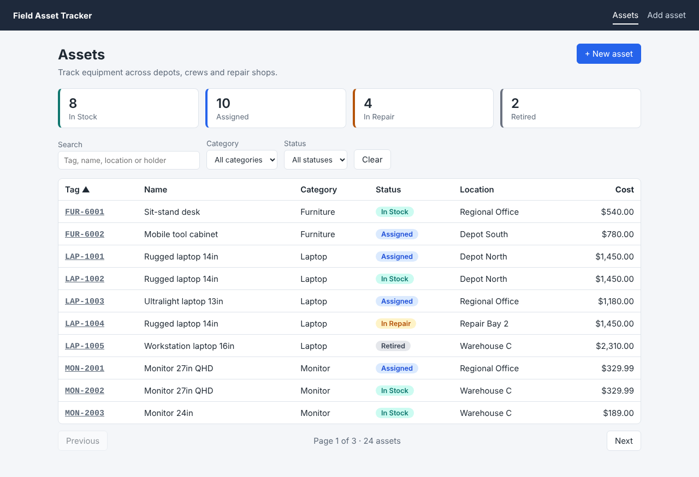
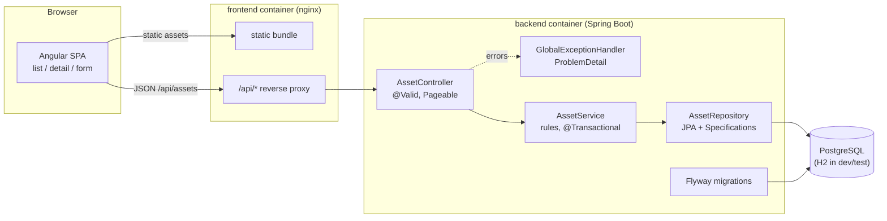
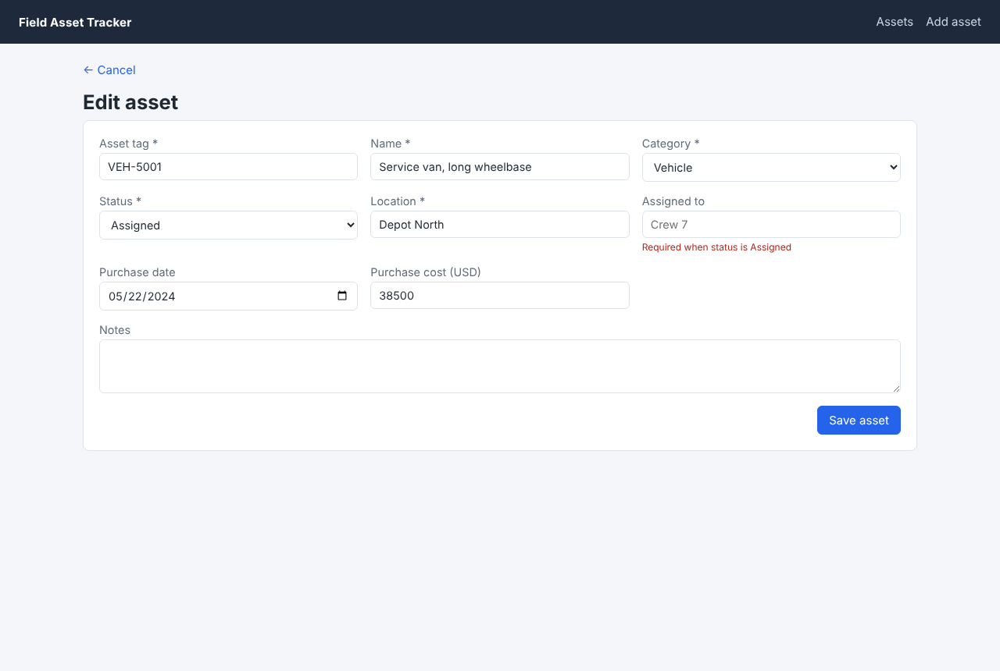

# Field Asset Tracker — Angular + Spring Boot

Full-stack inventory / asset-tracking application: a Spring Boot 3 REST API (Java 17) with an Angular single-page UI for listing, filtering, viewing, creating, editing and deleting field equipment.

> Representative portfolio project built independently with synthetic data; not derived from any employer or client codebase.



## Business use case

A field-services organisation issues laptops, handsets, tools and vehicles to crews working out of several depots. Operations staff need one place to answer: *what do we own, where is it, who has it, and what is out of service?* The app provides:

- a searchable, sortable, paginated asset register with per-status counts,
- create / edit forms that enforce data-quality rules (tag format, an "Assigned" asset must name a holder, a "Retired" asset cannot have one),
- consistent, machine-readable error responses that the UI maps back onto form fields.

## Features

| Area | What is implemented |
| --- | --- |
| REST API | CRUD on `/api/assets`, status summary endpoint, `201 Created` + `Location`, `204 No Content` on delete |
| Querying | Free-text search (tag, name, location, holder), category/status filters via JPA Specifications, `page`/`size`/`sort` with a max page size of 100 |
| Validation | Jakarta Bean Validation on the request record, plus service-level cross-field rules |
| Errors | RFC 9457 `ProblemDetail` (`application/problem+json`) for 400/404/409/422, with an `errors` map of field → message |
| Persistence | Spring Data JPA, Flyway migrations, H2 (PostgreSQL mode) by default, PostgreSQL via profile |
| API docs | OpenAPI 3 via springdoc — Swagger UI at `/swagger-ui.html` |
| Ops | Actuator health/liveness/readiness, multi-stage Dockerfiles, docker-compose, GitHub Actions |
| UI | Angular standalone components, signals, strict TypeScript, reactive forms with client-side validators mirroring the API, lazy-loaded routes, `HttpClient` service, plain CSS |

## Tech stack

- **Backend:** Java 17 · Spring Boot 3.5 · Spring Web MVC · Spring Data JPA (Hibernate 6) · Jakarta Validation · Flyway · H2 / PostgreSQL 16 · springdoc-openapi · JUnit 5 · Mockito · AssertJ · MockMvc
- **Frontend:** Angular 21 (standalone, zoneless, signals) · TypeScript (strict) · RxJS · Vitest + jsdom
- **Delivery:** Docker · docker-compose · nginx · GitHub Actions

## Architecture



```
backend/   Spring Boot service (com.portfolio.inventory: asset, config, error)
frontend/  Angular app (core = model + service, assets = list / detail / form)
docs/      screenshots
```

## Quick start

### Option A — local dev (no Docker)

Prerequisites: JDK 17+, Node 22.

```bash
# API on :8080 with in-memory H2 + 24 synthetic demo assets
cd backend
./mvnw spring-boot:run

# UI on :4200 (proxies /api to :8080 via proxy.conf.json)
cd frontend
npm ci
npm start
```

Open http://localhost:4200 · Swagger UI: http://localhost:8080/swagger-ui.html

### Option B — docker compose (PostgreSQL + API + nginx)

```bash
cp .env.example .env        # set a local-only password
docker compose up --build
```

UI: http://localhost:8081 · API/Swagger: http://localhost:8080/swagger-ui.html

## Configuration

| Property / env var | Default | Purpose |
| --- | --- | --- |
| `SPRING_PROFILES_ACTIVE` | *(none → H2)* | `postgres` switches to PostgreSQL |
| `DB_URL` | `jdbc:postgresql://localhost:5432/inventory` | JDBC URL (postgres profile) |
| `DB_USERNAME` | `inventory` | DB user (postgres profile) |
| `DB_PASSWORD` | *(required)* | DB password — environment only, never in source |
| `SPRING_FLYWAY_LOCATIONS` | `classpath:db/migration,classpath:db/demo` | drop `db/demo` to start without sample rows |
| `APP_CORS_ALLOWED_ORIGINS` | `http://localhost:4200` | allowed origins when the UI is served separately |
| `spring.data.web.pageable.max-page-size` | `100` | upper bound on `size` |
| `POSTGRES_USER` / `POSTGRES_PASSWORD` | from `.env` | used by docker-compose |

## API examples

```bash
# Assigned laptops, most recent purchase first
curl "http://localhost:8080/api/assets?category=LAPTOP&status=ASSIGNED&sort=purchaseDate,desc&page=0&size=10"

# Free-text search
curl "http://localhost:8080/api/assets?q=depot%20north"

# Counts per status
curl http://localhost:8080/api/assets/summary
# {"IN_STOCK":8,"ASSIGNED":10,"IN_REPAIR":4,"RETIRED":2}

# Create
curl -i -X POST http://localhost:8080/api/assets -H 'Content-Type: application/json' -d '{
  "assetTag":"TOL-4100","name":"Cordless drill kit","category":"TOOL","status":"IN_STOCK",
  "location":"Depot North","purchaseDate":"2025-03-01","purchaseCost":219.50}'
# HTTP/1.1 201   Location: http://localhost:8080/api/assets/25

# Validation failure -> 400 application/problem+json
curl -X POST http://localhost:8080/api/assets -H 'Content-Type: application/json' -d '{"assetTag":"bad"}'
```

```json
{
  "type": "https://example.org/problems/validation",
  "title": "Validation failed",
  "status": 400,
  "detail": "6 field(s) are invalid",
  "instance": "/api/assets",
  "errors": { "assetTag": "must look like ABC-1234", "name": "must not be blank" }
}
```

| Status | When |
| --- | --- |
| 400 | bean-validation failure, malformed JSON, unknown enum value, unknown sort property |
| 404 | asset id does not exist |
| 409 | duplicate `assetTag` |
| 422 | business rule (ASSIGNED without holder, RETIRED with holder) |

## Testing

```bash
cd backend && ./mvnw verify          # JUnit 5 unit, slice and integration tests
cd frontend && npm run test:ci       # Vitest (jsdom, headless)
cd frontend && npm run build         # production build
```

| Layer | Test class | Style |
| --- | --- | --- |
| Service rules | `AssetServiceTest` | JUnit 5 + Mockito, no Spring context |
| Persistence | `AssetRepositoryTest` | `@DataJpaTest` against Flyway-migrated H2 (PostgreSQL mode) |
| Web contract | `AssetControllerTest` | `@WebMvcTest` + MockMvc + `@MockitoBean`: status codes, problem JSON, paging defaults |
| API end to end | `AssetApiIntegrationTest` | `@SpringBootTest` + MockMvc: CRUD lifecycle, filters, sorting, OpenAPI, health |
| Frontend | `*.spec.ts` | service via `HttpTestingController`; components with a mocked service (paging/sorting/filter debounce, form validation and server field errors, detail/delete) |

CI (`.github/workflows/ci.yml`) runs the backend and frontend as two independent jobs.

## Screenshots

| Asset register | Edit form with validation |
| --- | --- |
|  |  |

## Security considerations

- No secrets in source: the DB password is read from `DB_PASSWORD`; `.env` is git-ignored and `.env.example` contains placeholders only.
- Error responses never include stack traces or SQL (`server.error.include-stacktrace: never`; integrity violations map to a generic 409).
- LIKE wildcards in search input are escaped; all queries use bound parameters via the Criteria API.
- Input is validated at the API boundary regardless of client-side checks.
- nginx serves the UI and proxies `/api` on the same origin, and adds `X-Content-Type-Options`, `X-Frame-Options`, `Referrer-Policy` and a CSP.
- The backend container runs as a non-root user; only the `health` and `info` actuator endpoints are exposed.
- **Not included:** authentication/authorisation. A production deployment would put the API behind OAuth2/OIDC (Spring Security resource server) with role-based access to write operations.

## Limitations & future enhancements

- No authentication, audit trail or optimistic locking (`@Version`) yet; concurrent edits are last-write-wins.
- Demo data is loaded by a Flyway migration; a real deployment would exclude `db/demo`.
- Search uses `LIKE`; PostgreSQL full-text search or trigram indexes would scale better.
- Future: Spring Security + OIDC, assignment history, CSV import/export, Testcontainers-based PostgreSQL tests, Playwright end-to-end tests in CI.

## License

[MIT](LICENSE)
